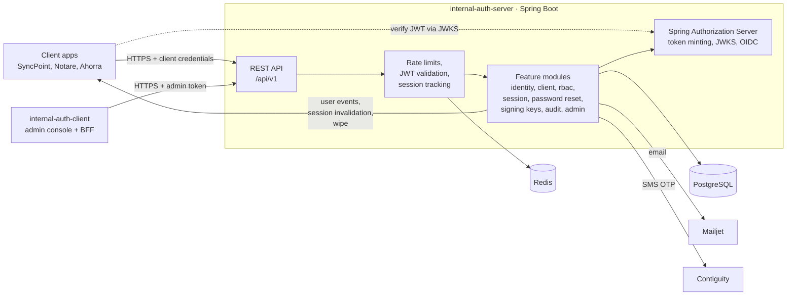
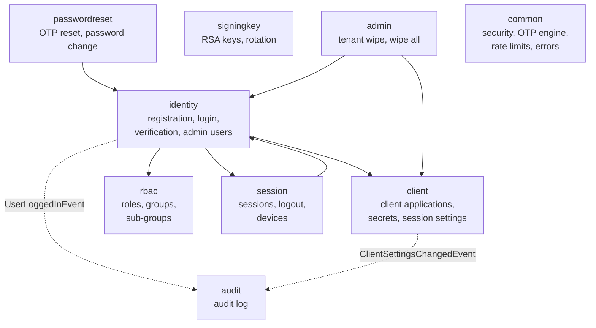
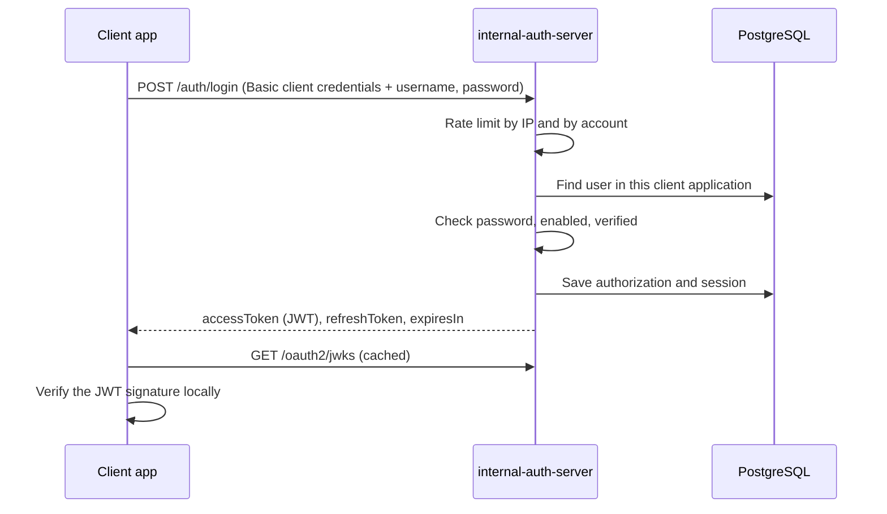

<div align="center">

# Internal Auth Server

**A self-hosted identity and access management service. It issues signed JWTs, manages users, roles and sessions for every app that plugs into it, and keeps each app's users isolated from the others.**

[](#technology-stack)
[](#technology-stack)
[](#authentication)
[](#technology-stack)
[](#api-overview)

</div>

---

## Table of Contents

1. [Project Overview](#project-overview)
2. [The Problem](#the-problem)
3. [The Solution](#the-solution)
4. [Features](#features)
5. [Technology Stack](#technology-stack)
6. [System Architecture](#system-architecture)
7. [Module Architecture](#module-architecture)
8. [Folder Structure](#folder-structure)
9. [Authentication](#authentication)
10. [Multi-Tenancy](#multi-tenancy)
11. [Sessions and Refresh Tokens](#sessions-and-refresh-tokens)
12. [Security](#security)
13. [API Overview](#api-overview)
14. [Error Handling](#error-handling)
15. [Configuration](#configuration)
16. [Running Locally](#running-locally)
17. [Testing](#testing)
18. [Deployment](#deployment)
19. [Author](#author)

---

## Project Overview

Internal Auth Server is the single source of truth for identity across a family of apps: SyncPoint, Notare and Ahorra. Each app registers as a **client application** and sends its users here to register, sign in, verify their email or phone, and reset their password. The server answers with signed access and refresh tokens that each app verifies on its own against the public JWKS.

An admin console ([internal-auth-client](https://github.com/EzeDev98/internal-auth-client)) sits on top of it for operators: users, roles, groups, client applications, sessions and signing keys.

## The Problem

Every app needs the same identity features, and building them separately in each one causes real problems:

- **Duplicated security code.** Password hashing, OTP flows, token signing and rate limiting get rewritten per app, and each copy drifts.
- **No central control.** Disabling a user, ending their sessions or rotating a signing key means touching every app.
- **Shared user tables leak across apps.** A user who signs up to one app should not exist in another unless they sign up there too.
- **Hosted IAM costs.** Keycloak needs its own heavy deployment; SaaS identity providers charge per user.

## The Solution

- **One service, many tenants.** Each app is a client application with its own isolated user namespace, credentials and session rules.
- **Standard tokens.** Access tokens are RS256 JWTs from Spring Authorization Server, with OIDC discovery and a JWKS endpoint, so any app can verify them without calling back.
- **Central control with push notifications.** Signing a user out everywhere is pushed straight to SyncPoint and Ahorra, and user deletes, disables and re-enables are pushed to Notare.
- **Operator tooling.** Role-based access control, session management, signing-key rotation, audit logging and a tenant data wipe, all behind admin-only endpoints.

## Features

- Registration with email activation links and SMS phone verification
- Login with per-IP and per-account rate limits
- Access and refresh tokens, with rotating or persistent refresh per client
- Password reset by SMS or email OTP, and password change for signed-in users
- Multi-tenant users: the same username can exist in two apps as two separate accounts
- Roles, permission groups and nested sub-groups (RBAC)
- Several signed-in devices per user, with a per-app session limit
- "Devices signed in" view: sign out one device or all others
- Admin user directory: create, update, disable, reset password, end sessions
- Client application management with secret rotation
- JWT signing-key rotation with zero downtime (old keys stay in the JWKS)
- Audit log of logins and client setting changes
- Push of user and session changes to SyncPoint, Notare and Ahorra
- Danger-zone wipe of one tenant, or of every connected app
- OpenAPI documentation with Swagger UI
- Health, metrics (Prometheus) and trace IDs on every response

## Technology Stack

| Area | Technology |
|---|---|
| Language | Java 21 |
| Framework | Spring Boot 4.1, Spring MVC |
| Security | Spring Security, Spring Authorization Server, OAuth2 Resource Server |
| Modularity | Spring Modulith (module boundaries and event publication) |
| Database | PostgreSQL (production), MySQL (local development) |
| Migrations | Flyway |
| Cache and rate limits | Redis via Redisson |
| Email | Mailjet |
| SMS | Contiguity |
| API docs | springdoc-openapi 3.1 |
| Observability | Spring Boot Actuator, Micrometer, Prometheus, Brave tracing |
| Testing | JUnit 5, Mockito, AssertJ, Testcontainers, WireMock, JaCoCo |
| Load testing | k6 |
| Build and CI | Maven, Docker, GitHub Actions |

## System Architecture



Client apps authenticate their own calls with HTTP Basic client credentials and verify user tokens locally against the JWKS. Solid arrows are direct calls; dotted arrows are token verification.

## Module Architecture

Each feature is a module with the same layers: `controller`, `service`, `repository`, `model`, `dto`, and where needed `client` (outbound HTTP), `config` and `event`. Spring Modulith enforces the module boundaries, and the audit trail is driven by events rather than direct calls.



Solid arrows are direct calls; dotted arrows are events. Every module can use `common`.

## Folder Structure

```
internal-auth-server/
├── src/main/java/com/internal/auth/
│   ├── common/              # Security helpers, OTP engine, rate limiter, encryption, errors
│   ├── config/              # Security, authorization server, Redis, async and OpenAPI config
│   └── feature/
│       ├── admin/           # Tenant wipe and cross-app wipe
│       ├── audit/           # Audit log and its events
│       ├── client/          # Client applications (tenants)
│       ├── identity/        # Registration, login, verification, admin user directory
│       ├── passwordreset/   # OTP password reset and password change
│       ├── rbac/            # Roles, permission groups, sub-groups
│       ├── session/         # Sessions, logout, signed-in devices
│       └── signingkey/      # JWT signing keys and rotation
├── src/main/resources/
│   ├── application.properties
│   ├── application-dev.properties
│   ├── application-prod.properties
│   └── db/migration/        # Flyway migrations
├── src/test/java/           # Unit and integration tests
├── scripts/load-tests/      # k6 load tests and a database outage chaos test
├── .github/workflows/ci.yml # CI pipeline
├── compose.yaml             # Local MySQL, Postgres and Redis
├── Dockerfile
└── pom.xml
```

## Authentication



- **Access tokens** are RS256 JWTs carrying the user's roles, `client_application_id` and session id (`sid`).
- **Signing keys** are stored encrypted (AES-256-GCM) and rotated through `POST /admin/signing-keys/rotate`. Retired keys stay published in the JWKS until existing tokens expire.
- **Service-to-service calls** use the OAuth2 `client_credentials` grant.
- **Discovery** is available at `/.well-known/openid-configuration` and `/.well-known/oauth-authorization-server`.

## Multi-Tenancy

Every user belongs to exactly one client application. Usernames, emails and phone numbers are unique **per client application**, not globally, so `alice` in SyncPoint and `alice` in Notare are two separate accounts with separate passwords and sessions. OTPs, sessions and audit entries are scoped the same way.

Roles and permission groups are deliberately global, so an operator defines them once and assigns them to users in any app.

## Sessions and Refresh Tokens

Each client application controls its own session behaviour:

| Setting | Effect |
|---|---|
| Refresh token rotation | On: every refresh issues a new refresh token. Off: the same refresh token slides forward on each use. |
| Refresh token lifetime | How long a refresh token lives, in days. |
| Maximum session lifetime | Hard cap after which the user must sign in again, even with an active persistent token. |
| Maximum active sessions | How many devices one user may be signed in on at once (1 to 20). |
| Revoke prior sessions on login | Signs out the user's other devices when they log in. |

When an admin signs a user out everywhere, SyncPoint and Ahorra are told straight away instead of waiting for tokens to expire. User deletes, disables and re-enables are pushed to Notare the same way.

## Security

- Passwords are hashed with `PasswordEncoder`; tokens and OTPs that need exact-match lookup are stored as SHA-256 hashes, never in plain text
- Client secrets and signing keys are encrypted at rest with AES-256-GCM
- A guard test fails the build if a credential hash is ever compared with `equals`
- Rate limits on every sensitive endpoint, backed by Redis, and they fail closed if Redis is down
- Login errors never reveal whether the username or the password was wrong
- Destructive admin endpoints require a separate secret and a typed confirmation phrase
- Actuator endpoints run on a separate management port in production
- Flyway `clean` is disabled in production

## API Overview

All endpoints sit under `/api/v1`. Full request and response schemas are in Swagger UI at `/swagger-ui.html`.

| Area | Endpoints |
|---|---|
| Registration and verification | `POST /auth/register`, `GET/POST /auth/activate`, `POST /auth/resend-activation`, `POST /auth/verify-phone`, `POST /auth/resend-phone-verification` |
| Login and tokens | `POST /auth/login`, `POST /auth/refresh-token`, `POST /auth/session-status`, `POST /auth/change-password` |
| Password reset | `POST /password-reset/request`, `/verify-otp`, `/complete`, `/email/request`, `/email/verify-otp` |
| Admin accounts | `POST /admin/register`, `/admin/login`, `/admin/refresh-token`, `/admin/password-reset/*` |
| Users | `GET/POST/DELETE /users`, `GET/PATCH /users/{username}`, `/users/{username}/credentials`, `/users/{username}/sessions` |
| Roles and groups | `/roles`, `/groups`, `/groups/{group}/subgroups`, `/users/{username}/roles`, `/users/{username}/permission-groups` |
| Sessions | `GET/DELETE /session`, `DELETE /session/all`, `DELETE /session/others`, `DELETE /session/{sessionId}`, `GET /admin/sessions` |
| Client applications | `GET/POST /client-applications`, `GET/PATCH /client-applications/{clientId}`, `POST /client-applications/{clientId}/rotate-secret` |
| Signing keys | `GET /admin/signing-keys`, `POST /admin/signing-keys/rotate` |
| Danger zone | `POST /admin/reset/wipe-tenant`, `POST /admin/reset/wipe-all` |

## Error Handling

Every response, success or failure, uses the same envelope:

```json
{
  "success": false,
  "message": "Username or password is incorrect",
  "data": null,
  "errorCode": null,
  "timestamp": "2026-11-28T14:00:00Z"
}
```

A single `GlobalExceptionHandler` maps every exception to an HTTP status; RBAC errors also carry a specific `errorCode`. Unexpected errors return a generic message; details are only logged. Each response also carries an `X-Trace-Id` header for matching a request to its logs.

## Configuration

Configuration lives in `application.properties`, with `dev` and `prod` profiles. Values come from environment variables.

| Variable | Purpose |
|---|---|
| `SPRING_PROFILES_ACTIVE` | `dev` (MySQL, no Flyway) or `prod` (PostgreSQL, Flyway) |
| `PORT`, `BASE_URL` | Server port and public URL |
| `SELF_ISSUER_URI` | Token issuer URI |
| `ACCESS_TOKEN_TTL_MINUTES`, `REFRESH_TOKEN_TTL_DAYS` | Default token lifetimes |
| `AUTH_SIGNING_KEY_PEM` | Optional RSA key to seed the first signing key |
| `SECRET_ENCRYPTION_KEY` | AES-256 key for secrets stored in the database |
| `POSTGRES_URL`, `POSTGRES_DB`, `POSTGRES_USER`, `POSTGRES_PASSWORD` | Production database |
| `REDIS_HOST`, `REDIS_PORT`, `REDIS_PASSWORD` | Redis |
| `MAILJET_API_KEY`, `MAILJET_SECRET_KEY`, `MAILJET_SENDER_EMAIL` | Email delivery |
| `CONTIGUITY_API_KEY` | SMS delivery |
| `CORS_ALLOWED_ORIGINS` | Allowed browser origins |
| `ADMIN_RESET_SECRET` | Secret required by the wipe endpoints |
| `*_SESSION_INVALIDATE_*`, `*_WIPE_*`, `NOTARE_USER_EVENTS_*` | URLs and secrets for pushing changes to connected apps |

Email and SMS fall back to logging when no provider is configured, so local development needs no external accounts.

## Running Locally

Requirements: Java 21, Docker, and MySQL and Redis (or the services in `compose.yaml`).

```bash
git clone https://github.com/EzeDev98/internal-auth-server.git
cd internal-auth-server
./mvnw spring-boot:run
```

The server starts on `http://localhost:5151`. Swagger UI is at `http://localhost:5151/swagger-ui.html`.

## Testing

```bash
./mvnw test      # unit tests, no Docker needed
./mvnw verify    # unit and integration tests, Docker required
```

- **Unit tests** cover services, validators, mappers, the exception handler and the OTP engine.
- **Integration tests** run against real PostgreSQL and Redis containers (Testcontainers), and external providers are stubbed with WireMock.
- They cover the full migration chain, rate limits, multi-tenant isolation, IDOR protection, the security allow-list and Redis outage behaviour.
- **Guard tests** fail the build on unsafe credential comparisons and unreviewed `TRUNCATE` migrations.
- A JaCoCo coverage report is written to `target/site/jacoco/index.html`.
- **Load and chaos tests** live in `scripts/load-tests/`: k6 scripts for login and signing-key rotation, and a script that stops Postgres mid-traffic to check recovery.

## Deployment

The service ships as a Docker image built by the multi-stage `Dockerfile`. In production it runs with the `prod` profile against PostgreSQL and Redis, with Flyway applying migrations on startup. GitHub Actions runs the unit tests on every push and the integration tests on pull requests.

## Author

**Eze Moses John**
Built by Building with Eze.
